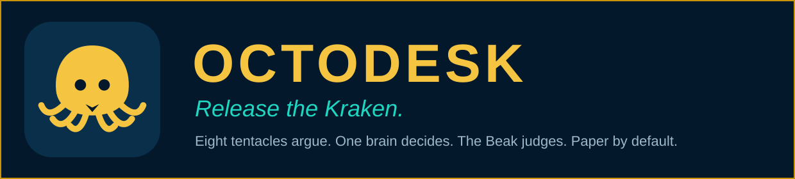
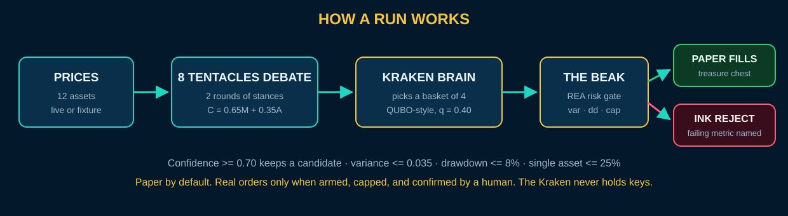
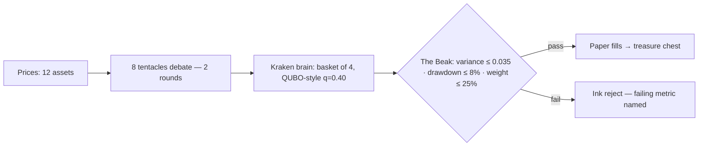

# OctoDesk — Release the Kraken

[](#verified)
[](pyproject.toml)
[](LICENSE)
[](#)
[](#the-modes-ladder)

An installable, super-easy, slightly ridiculous trading-desk bot. The main agent is a **Kraken**. Its **eight tentacles are sub-agents** that argue about twelve stocks in two rounds. Its **brain** picks a basket of four with a QUBO-style objective. Its **beak** is a hard risk gate that can veto everything. You don't read a dashboard — you *watch it happen* in the Kraken Pit, then the Doubling Lab teaches you why exponential fantasies stay fantasies.

Under the jokes is the author's real desk pattern (H-QRD risk gate + swarm debate, sibling of [swarm-desk](https://github.com/EdgeAgent/swarm-desk), reimplemented fresh here): deterministic scoring, a confidence threshold, classical basket enumeration, and a gate that rejects more than it approves.

## Meet the cast

| Who | Real job |
|---|---|
| **The Kraken** | Orchestrator. Runs the desk, delivers the verdict. |
| **The Brain** | "Quantum coprocessor": enumerates baskets of 4 from 12, minimizing energy `−mean(momentum) + q·variance`, `q = 0.40`. Classical enumeration standing in for QAOA p=2 — no quantum hardware. |
| **Bull** 🐂 tentacle | Momentum-chaser. Long what's rising. |
| **Bear** 🐻 tentacle | Short-side skeptic. Fades what's rising. |
| **Momentum** tentacle | Pure trend: 20-day and 5-day thrust. |
| **Value** tentacle | Buys dips below the 50-day mean. |
| **Contrarian** tentacle | Fades the crowd on principle. |
| **Sentiment** tentacle | Chases short-term buzz and volume of movement. |
| **News Hawk** tentacle | Volatility-reactive; circles sudden moves. |
| **Risk** tentacle | Hates chop. Calm water or nothing. |
| **The Beak** | REA risk gate. Veto power over the whole desk. |

Each tentacle scores every asset from price features (momentum, mean reversion, trend, volatility) with fixed weights. Round 1: they argue. Round 2: each hardens 25% toward the pod's mean — positions harden, extremists soften. Per-asset swarm confidence is `C = clip(0.65·M + 0.35·A, 0, 1)` where `M` is the mean stance mapped to 0..1 and `A` is an agreement factor. **C ≥ 0.70 keeps a candidate.**

## How a run works





**The Kraken Pit** (the main view) stages all of it as a scene, not a spreadsheet: an underwater set with light rays, seaweed, and rising bubbles; the Kraken centre-stage on its rock; tentacles lighting up in turn with verdict bubbles; round banners ("ROUND 1 — THE TENTACLES ARGUE" → "THE BEAK JUDGES"); the round-2 loudest bull and bear paired off with a VS glow; coins flying into the treasure chest on a pass, an ink cloud and a shake on a reject. The game HUD tracks paper NAV as a coin counter, your gate-pass streak as a flame, and a cosmetic LVL that rises with runs. Speed selector: **Chill 1x / Fast 2x / TURBO**. If JavaScript animation is unavailable, every verdict still lists as plain text under the scene.

## Quickstart

```bash
# macOS / Linux
./setup.sh
# Windows
./setup.ps1        # also drops a Desktop shortcut
```

Then:

```bash
octodesk           # serve the Pit → open http://127.0.0.1:8917
octodesk demo      # one full desk run in the terminal, offline fixture data
octodesk run-once  # same, live prices (fixture fallback if the network sulks)
```

Hit **RELEASE THE KRAKEN**. Toggle **Demo mode** to run entirely on the bundled fixture prices. Live prices come from Yahoo Finance's chart API and are cached; the engine itself runs in seconds either way.

## The Doubling Lab

Below the Pit: a small shrine to exponential math, labelled everywhere as **math, not a promise**.

- **The Ladder** — press play and watch $1 double, step by step (at your chosen playback speed). $1,024 at step 10. **MILLION!** at step 20: $1,048,576. A coin stack grows as it climbs.
- **Fold to the Moon** — fold a 0.1 mm sheet 0–42 times. At 42 folds the stack is ≈ 439,805 km thick — past the Moon (384,400 km). A real sheet gives up around fold 7 or 8; the math doesn't.
- **Fantasy vs Kraken** — sliders (start $, % per week, weeks) draw the smooth exponential "fantasy curve." Overlaid: your paper portfolio's *actual* NAV history, indexed — the jagged teal one. The math of doubling is not a prediction, and the chart says so.

## The modes ladder

| Mode | What can happen |
|---|---|
| **paper** (default) | Simulated money only. Broker panels show the shape of things, nothing real can move. |
| **connected** | SnapTrade connected: real Wealthsimple balances and holdings show in the app. Placement still impossible. |
| **armed** | Placement is possible — under every guard below. |

Placement requires **all** of: mode `armed` · the order is a proposal this server issued from a gate-passed run · the proposal's one-shot **confirmation token** is presented (the CONFIRM button — a human confirms every order) · amount ≤ per-order cap (default **$100**) · day's placements ≤ daily cap (default **$250**, enforced against a daily spend ledger). Any failed check refuses with the specific reason. The **KILL SWITCH** (big red button) slams the app back to paper and blocks placement — and re-arming — until a human manually clears it.

## Going real — Wealthsimple via SnapTrade

Wealthsimple has **no official API**. The sanctioned route is **SnapTrade**, the aggregator Wealthsimple supports for third-party access: its Broker Access Guide lists Wealthsimple as **"Read and Trade,"** available once a Production Access Application is approved. The free plan covers up to 5 connections.

The owner's three steps:

1. **Sign up at [snaptrade.com](https://snaptrade.com)** (free) and file the Production Access Application.
2. **Put the keys in the environment** — `OCTODESK_SNAPTRADE_CLIENT_ID` and `OCTODESK_SNAPTRADE_CONSUMER_KEY` — ideally via your Secure Vault. Never in chat, never in code, never in a config file (the app only reads them from env vars, and never logs them).
3. **Connect Wealthsimple inside SnapTrade's hosted Connection Portal.** The app hands you the portal link; your Wealthsimple password is typed into SnapTrade's portal and nowhere else.

> ⚠️ **Warning:** unofficial libraries that log in with your Wealthsimple password exist. Do not use them. They violate Wealthsimple's terms and risk account termination — and any tool asking for your broker password is a tool you should delete. This app will never ask.

**v1 live still means a human confirms every order.** Unattended auto-trading is deliberately not in v1.

With no SnapTrade keys, the broker layer runs on a clearly-labelled demo transport (`FakeTransport`) so every screen and guard can be exercised safely.

## Wallet — watch-only crypto

Paste a **public** EVM address and the Kraken reads ETH / USDT / USDC / WETH balances from a public JSON-RPC endpoint. It refuses — loudly — anything shaped like a private key or seed phrase. Gate-passed runs also produce **unsigned** trade proposals: export-only dicts with no key, signature, or transaction fields. Nothing here can move funds. The future unlock is WalletConnect signing: add your own free Reown project id, and proposals get signed **inside your own wallet, one signature per transaction** — your signature is the approval gate.

## Safety constitution

- **Paper-first.** Paper is the default mode, and the kill switch's home address.
- **The app never sees your Wealthsimple password. Ever.**
- **No keys, no seeds, no passwords.** Config loading hard-fails on any key that even looks like one; the wallet module refuses key/seed-shaped input.
- **SnapTrade keys live in environment variables only** — never config files, never logs.
- **Caps and the kill switch always win** over any proposal, mode, or button.
- **A human confirms every real order in v1.** No unattended trading.

## Roadmap

- WalletConnect (Reown) in-wallet signing of proposals
- More brokers via SnapTrade; exchange read-only balances
- Signed Windows installer attached to releases (CI already builds the .exe — see `.github/workflows/build-windows.yml`; grab it from the workflow artifacts, or build locally with `pyinstaller packaging/octodesk.spec`)

## Honesty section

- The "quantum coprocessor" is **classical enumeration** standing in for QAOA p=2. No quantum hardware exists anywhere in this app, and the label says so in the code, the UI, and here.
- Persona scores are **deterministic heuristics over price features — not financial advice**, not signals with a track record, not a promise of anything.
- Caution is the default setting, by design: in this desk pattern's first live-data test (see swarm-desk), the swarm kept **0 of 12** assets and the gate rejected the basket. The Kraken saying "no" is a feature.
- The Doubling Lab is exponential **math**, exhibited precisely because real returns never look like that.
- The bundled fixture prices are plausible synthetic series for offline use — labelled as such, never presented as market data.
- Scene art is **original SVG**; the staging is inspired by AI Town's watchable-agent pattern (MIT) — **no third-party game assets or code** are used.
- SnapTrade request signing follows SnapTrade's published scheme; without production keys, only the demo transport is exercised end-to-end.

## Verified

30 tests, no network: debate determinism, aggregation boundaries (0.70 keep/prune), each gate failure mode (variance, drawdown, cap), paper fills only on a pass, key/seed refusal in config and wallet, unsigned-only proposals, CSV parsing, growth math (step 20 to $1M; fold 42 past the Moon), the full broker flow on `FakeTransport`, and the modes ladder — placement refused in paper, refused in connected, refused without a token, refused over both caps, refused after the kill switch, allowed **exactly once** when armed + confirmed + under cap.

```bash
pip install -e . pytest && python -m pytest
octodesk demo
```

## License

MIT © Kevin Doherty
